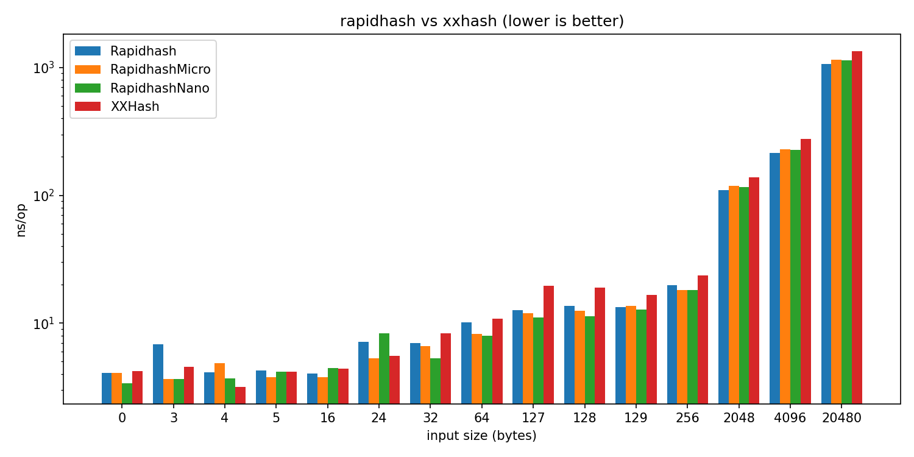

# rapidhash_go

This is pure go implementation of Rapidhash without assembly and with true streaming API (instead of just collecting all data into buffer and hashing in the end).  You can read more info about `rapidhash` in original repo: [https://github.com/Nicoshev/rapidhash](https://github.com/Nicoshev/rapidhash). It is faster successor of wyhash already being used in many projects.

Previous version port can be found at [V1 branch](https://github.com/poiug07/rapidhash_go/tree/v1).

## Usage

```go
package main

import (
	"fmt"

	"github.com/poiug07/rapidhash_go"
)

func main() {
	fmt.Println(rapidhash_go.Rapidhash([]byte("hello")))

	// With a custom seed:
	fmt.Println(rapidhash_go.RapidhashWithSeed([]byte("hello"), 42))

	// Faster for most inputs, at the cost of slightly larger code:
	fmt.Println(rapidhash_go.RapidhashMicro([]byte("hello")))

	// Smallest code size, best for very short inputs:
	fmt.Println(rapidhash_go.RapidhashNano([]byte("hello")))
}
```

Use `Rapidhash` as the general-purpose default; switch to `RapidhashMicro` or `RapidhashNano` only when their size/speed trade-offs matter for your workload.

For incremental/streaming hashing (e.g. reading from a stream or file), use `Digest`, which implements `hash.Hash` and produces the same result as a one-shot hash of all bytes written:

```go
h := rapidhash_go.New()   // or NewSeed(42)
io.Copy(h, file)
fmt.Println(h.Sum64())
```

## Benchmarks

Comparison against [xxhash](https://github.com/cespare/xxhash) on AMD Ryzen 5 4600H, linux/amd64. Results in ns/op (lower is better):

| input size (B) | rapidhash | rapidhash Micro | rapidhash Nano | xxhash |
|---------------:|----------:|----------------:|---------------:|-------:|
| 0              | 4.09      | 4.05            | 3.37           | 4.23   |
| 16             | 4.04      | 3.76            | 4.46           | 4.41   |
| 32             | 7.00      | 6.62            | 5.29           | 8.30   |
| 64             | 10.15     | 8.23            | 8.00           | 10.82  |
| 128            | 13.64     | 12.47           | 11.36          | 19.01  |
| 256            | 19.80     | 18.22           | 18.24          | 23.70  |
| 2048           | 110.00    | 118.50          | 116.50         | 137.70 |
| 4096           | 214.60    | 228.90          | 227.60         | 276.40 |
| 20480          | 1064.00   | 1146.00         | 1134.00        | 1350.00 |

Throughput chart, generated by [benchmarks/plot.py](benchmarks/plot.py):



To reproduce (results are also saved to [benchmarks/results_latest.txt](benchmarks/results_latest.txt), keeping the raw `go test -bench` output so exact numbers can be compared between runs):
```
cd benchmarks
go test -run=NONE -bench=. -benchtime=100000x -count=3 . | tee results_latest.txt | python3 plot.py
```

## Equivalence to C++ implementation

To run tests you can just run `go test`.

No fancy comparison or comprehensive test set. Just some strings.
`additional/file.csv` is output of [additional/test.cpp](additional/test.cpp). I didn't include rapidhash header file, you just can copy it if you want to regenerate `file.csv`.

## License and Acknowledgements

This project is licensed under BSD-2 License. Please raise a PR with a justification on why other license is better if you would like to propose change.

Thanks to [Nicolas De Carli](https://github.com/Nicoshev) for the original [rapidhash](https://github.com/Nicoshev/rapidhash) C++ implementation, which is licensed under the MIT License.

Other places where I took insipiration and code:
* [Rust port of rapidhash by hoxxep](https://github.com/hoxxep/rapidhash)
* [rapidhash port by dwisiswant0](https://github.com/dwisiswant0/rapidhash)
* [xxhash go port by cespare](https://github.com/cespare/xxhash)